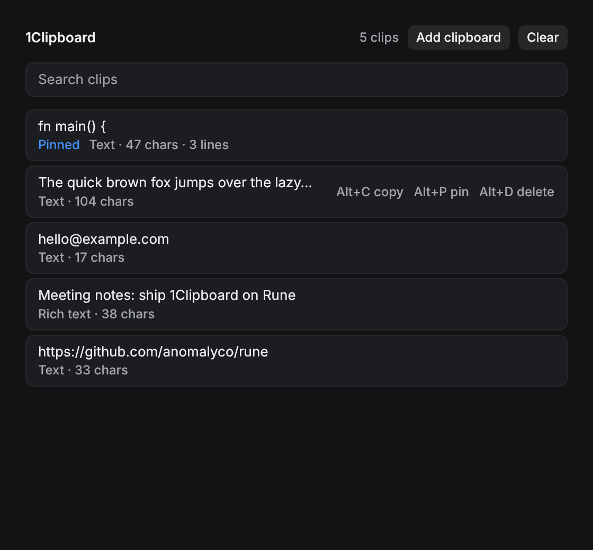

<p align="center">
  
  <h1 align="center">1Clipboard</h1>
  <p align="center"><b>A universal clipboard managing app that makes it easy to access your clipboard from anywhere on any device.</b></p>
  <p align="center"></p>
</p>

# 1Clipboard

**1Clipboard is a native clipboard history manager written in Rust with [Rune](https://github.com/anomalyco/rune)**, a GPU-rendered UI framework for macOS, Windows and Linux. It replaces the earlier Electron + Angular + ngrx + PouchDB version.

- Watches the clipboard and keeps what you copy, newest first (plain text, HTML and images).
- Click a clip to put it back on the clipboard, with its formatting.
- Keyboard shortcuts act on the clip under the pointer (the hovered row lists them):

  | Shortcut | Action |
  | --- | --- |
  | Alt+C (⌥C) | Copy it back to the clipboard |
  | Alt+P (⌥P) | Pin it to the top, or unpin it if it's pinned |
  | Alt+D (⌥D) | Delete it |

  They work even while the search field has focus; with no clip hovered, keys type as usual.
- **Clear** removes everything that isn't pinned.
- Search as you type. Cmd/Ctrl-V into the window, or **Add clipboard**, adds the current clipboard.
- History is saved as JSON in your data folder (`~/.local/share/1Clipboard/history.json`, `~/Library/Application Support/1Clipboard/`, or `%APPDATA%\1Clipboard\`), or wherever `ONECLIPBOARD_HISTORY` points. Images are kept for the session only.

## Build and run

```sh
cargo run --release
```

Rust is pinned in `rust-toolchain.toml`; `rustup` installs it on first build. On Linux, install the build dependencies first (Debian/Ubuntu: `apt-get install libxkbcommon-dev libwayland-dev`; windowed runs also need `libxkbcommon-x11-0`).

## Testing

```sh
cargo test                     # model + UI tests on Rune's headless runtime, with an in-memory clipboard
B=target/release/oneclipboard
$B --list-scenes               # sample, search, copied, hover
$B --snap out.png --scene sample              # render to PNG with no window
$B --tree tree.json --scene sample            # dump the element tree
$B --script scripts/demo.json --snap end.png --at mark:end   # scripted paste, hover, Alt+P and Alt+C
```

Headless runs never read or write the saved history. Without a GPU, use a software Vulkan driver, e.g. `VK_ICD_FILENAMES=/usr/share/vulkan/icd.d/lvp_icd.json`.

## Note

The released version on [1clipboard.io](http://1clipboard.io) is the older Electron app.

## Download

You can download the current released version of 1Clipboard for Windows, and macOS from [http://1clipboard.io](http://1clipboard.io).

## Support

If you like this project, you can support me by starring this repository or getting in touch at <contact@1clipboard.io>

## License
MIT © [wiziple](https://github.com/wiziple)
